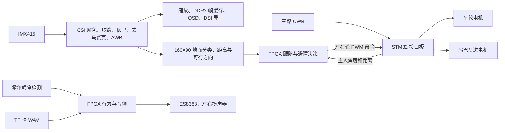

# MinecraftDog FPGA 开发基线

梳理日期：2026-10-29。以当前工作区源码为准；这是阅读和验证记录，不是新的上车版本。

## 1. 已确认的协作方式

- 项目是嵌入式大赛 FPGA 赛道的**自主选题**，按现有 MLKPAI-F02、MIPI DSI 屏和 STM32 接口板方案继续开发。参考选题指南中的 HDMI 要求不作为本项目的开发约束。
- 主工作区：`E:\FPGA\MinecraftDog\Minecraft_MLKfpgacode`。
- 后续流程：修改代码 → 相关仿真 → TD 综合、布局布线和时序检查 → 交付 bit → 用户上车验证并反馈。
- 新 bit 的交付目录：`E:\FPGA\MinecraftDog\Minecraft_MLKfpgacode\mcproject_code\src\boot`。
- `Minecraft_MCU/MinecraftDog_mspm0` 已弃用，本次未阅读其实现。源码中的 `m0`、`MSPM0` 命名有历史遗留，当前通信对象实际是 STM32。
- 用户确认：镜头离地 **174 mm**、向下倾 **15°**、车宽约 **20 cm**，安装未变。（**10-30 更正**：用户说镜头是竖直装的，实测画面下 1/3 约 2 m；距离表已按这个重算，见 `obstacle.md` §1。）
- 用户确认：`OBS_YSPREAD=4` 的 boot 版本**尚未上车测试**，先完成项目梳理。
- 工作区在本次阅读前已有多项未提交修改，包括 RTL、测试、文档、工程清单、Logo 和 boot bit；全部保留。本次不修改功能代码、不替换 bit。

## 2. 阅读范围和工程入口

| 位置 | 内容和用途 |
|---|---|
| `Minecraft_MLKfpgacode/README.md` | 开发入口、硬件说明、调试历史和当前问题 |
| `mcproject_code/MinecraftDog_FPGA.al` | TD 工程，顶层 `mctop`，PH1P35MDG324，速度等级 -3；清单中 102 个文件路径均存在 |
| `mcproject_code/src/rtl` | 系统、视频、避障、跟随、通信、音频、霍尔和保留的尾巴实现 |
| `mcproject_code/src/ip` | PLL、DDR2、FIFO、行缓存 RAM、面板初始化 ROM 等厂商 IP |
| `mcproject_code/src/pin` | `mc_pin.adc` 管脚约束、`mc_timing.sdc` 时钟约束 |
| `mcproject_code/src/sim` | 31 个测试入口，以及 SD/I2C 行为模型和视频/DDR 替身 |
| `Minecraft_MLKfpgacode/tools` | 仿真、TD 构建、工程清单生成、字体/Logo/距离表/伽马表/状态文字生成、音频转换 |
| `Minecraft_MCU/MinecraftDog_STM32` | STM32F103RCTx；UWB 数据处理、FPGA 串口、电机、尾巴、按键、LCD、独立跟随测试模式 |
| `source` | 技术文档及模板、参考赛题指南、授权书、音频源和 TF 卡音频、配图及生成脚本 |
| `3Dmodel` | Fusion 设计、整机及分件 STL；结合整机渲染图核对头部、机身、腿和尾巴的结构关系 |

重点通读了自研 FPGA 主链路和 STM32 应用/通信实现，核对了测试范围、工程清单、生成器和历史构建结果。厂商加密 IP 只能核对公开接口、实例参数和配套约束，不能读取内部实现；HAL/CMSIS 等通用库、生成的常量表、二进制模型和构建产物按依赖与资源核查处理。本记录不等同于全库逐行缺陷审计或实机验收。

## 3. 当前功能划分

正常模式下，跟随和视觉避障决策在 FPGA；STM32 接收三路 UWB 并选择目标，把左右轮命令落实到电机，另外控制尾巴。STM32 按键进入的独立跟随模式会接管电机：长按 KEY1 进入，长按 KEY2 退出。排查 FPGA 修改是否生效时，要确认车处于正常模式。

FPGA `tail/mc_tail.v` 和 `mc_stepper_emm.v` 仍保留，但顶层实例和输出管脚已经注释。`mc_behavior` 的喂食音效有效，顶层 `I_near`、`I_bark` 接常量 0；不能把模块具备的摇尾/狗叫能力当作当前整机已经启用的功能。

## 4. 视频与显示

- 输入：IMX415 四 lane RAW10，解包后每拍四像素。取窗 1920×1080，当前 `CROP_X0_GRP=1`、`CROP_Y0=13`；奇数起始行与 RGGB 去马赛克相位配套。
- 处理顺序：减黑电平 50 并查 sRGB 伽马表 → 双线性去马赛克 → AWB。AE 使用帧亮度统计，通过相机 I2C 调曝光和增益。
- ISP 输出分两路：显示路按 12:5 缩放为 800×448，打包成 128 位字进入 DDR2；避障路按每 12×12 求平均得到 160×90 网格。
- 显示使用 DDR2 四缓冲及厂商读写接口，输出 800×1280 竖屏。800×448 满足帧缓存突发长度约束，不能随意改成 800×450。
- 屏幕布局：相机 v=0…447；状态方块 v=456…495；五行文字左上角 (40,504)；480×128 Logo 左上角 (160,678)；方向条 v=820…827；避障图从 v=830 开始，高 450。
- `mc_mixer` 有固定流水延迟，文字、Logo、相机、避障图和状态方块需要保持像素与命中信号一致；修改布局/图层要跑 `tb_mixer` 及相应图层测试。
- 当前 DSI 水平前后肩 HSA/HBP/HFP=24/136/160，纵向 VSA/VBP/VFP=6/15/16。现有文档记录了缩短水平消隐造成的包发送问题，调整前要核对厂商 DSI 接口约定。

主要时钟为板载 25 MHz、系统 100 MHz、相机配置 24 MHz、面板初始化 10 MHz、CSI 字节时钟约 111.375 MHz、DSI 字节时钟约 68.49 MHz，以及 DDR 用户时钟。当前显示约 46.4 fps。时钟组间被 SDC 声明为异步，时序通过并不能代替跨域协议检查；新增跨域信号需明确同步器、握手或 FIFO 的约定。

## 5. 避障和跟随基线

| 参数/机制 | 当前值 |
|---|---|
| 地面参考区 | 网格 x=56…103、y=82…89，共 384 格 |
| 分类 | 亮度 `Y=(R+2G+B)>>2`；Cb/Cr 二维直方图和 Y 直方图共同判地面 |
| 学习 | 帧间衰减并累加参考区统计；色度邻域平滑，亮度邻域由 `YSPREAD` 控制 |
| `OBS_TC` / `OBS_TY` | 12 / 12 |
| 顶层 `OBS_YSPREAD` | **4**；底层模块默认值仍可为 2，由顶层传参覆盖 |
| 去噪和扫描 | 3×3 多数判断；列内至少连续两行；16 个扇区；相邻重叠障碍合框 |
| 几何表 | 174 mm / 15°，车宽 20 cm，两侧各留 5 cm，最远判定 150 cm（10-30 起：竖直装，按实测反推 −3.04°，判断 51 cm ~ 2 m） |
| 可行方向 | 9 个候选方向，编号 4…12；按车宽检查各方向的可行距离 |
| 显示建议停止阈值 | `OBS_D_STOP=35 cm` |
| 实际跟随绕行阈值 | `AVOID_CM=100`、`CLEAR_CM=60`、`SPIN_CM=45`；与显示建议不是同一套停止判断 |
| 跟随更新周期 | 20 ms |
| 到主人停止距离 | `FOLLOW_STOP_CM=300 cm` |
| 前进 PWM | 起步 3000，距离比例系数 10，前进上限 5000，轮命令上限 6500 |
| 角度与原地转 | 1/3 平滑、5° 死区；超过 90° 持续 300 ms 进入原地转，低于 40° 退出 |
| 斜坡 | 每 20 ms 加速最多 200、减速最多 400；停车分支直接清零命令 |
| 绕行保持 | 500 ms；方向代价为目标角度偏差×2，加上次方向偏差×1 |

当前最需要实机确认的是 README 中记录的反光/阴影地面误判：放宽亮度容差可能减少误报，也会减弱亮度差异对同色障碍的区分能力。测试台验证计算符合模型，并不证明真实地面分类准确。

这是一种基于外观的单目方法：距离由安装几何和地面假设推算，不能视为直接深度测量。类似方法的原论文明确以障碍外观可区分、地面较平和无悬空障碍为前提；本项目采用自己的 Y/Cb/Cr 简化实现，并非完整复现论文。参考：[Ulrich & Nourbakhsh, AAAI 2000](https://cdn.aaai.org/AAAI/2000/AAAI00-133.pdf)。

代码还会持续学习参考区中的外观。若障碍长期进入参考区，模型可能把它吸收为地面；该行为在现有仿真场景中也被覆盖。后续若需改变，需要连同学习策略和测试期望一起设计。

## 6. STM32 链路和执行端

| 方向 | 协议与含义 |
|---|---|
| STM32 → FPGA | 115200、8N1；`$l12350&` 表示左 12°、350 cm；`$S&` 表示目标丢失 |
| FPGA → STM32 | `#+3000-0500*` 为左右轮有符号 PWM；`#S*` 为停车 |
| 接线 | FPGA CEP3/L15 TX → STM32 PB11；FPGA CEP4/L16 RX ← STM32 PB10；共地 |
| FPGA 接收超时 | 300 ms 无有效目标帧，目标失效；字节链路活动另有状态 |
| FPGA 视觉超时 | 100 ms 没有新的避障结果，进入 NCAM 停车 |
| STM32 执行超时 | 200 ms 无完整 FPGA 命令帧，停止电机；另检查 UWB 有效性 |

角度字段只有两位，STM32 发给 FPGA 前限制到 ±99°；距离字段只有三位，限制到 999 cm。STM32 独立跟随模式使用原始 UWB 值，因此不能把两种模式在所有输入范围内视为完全等价。

STM32 `motor.h` 当前左右交换、两个方向反相均启用，非零 PWM 还有 75 的死区补偿。后续如发现转向反了，先核对这一层和实际接线，避免在 FPGA 再做一次相反补偿。

STM32 尾巴逻辑：上电回零；主人小于 300 cm 持续 300 ms 后开始摇尾，达到 320 cm 退出近距离状态；也可由 KEY2 短按触发。当前 FPGA 霍尔喂食信号没有经这条串口协议传给 STM32 尾巴。

## 7. 音频与资源

- TF 卡用 SPI 读 FAT32，根目录数字文件名 `1.WAV`…`64.WAV`；共享挂载/目录，两路文件读取经扇区仲裁共用 SD 控制器。
- 当前左扬声器播背景音乐 1.wav，右扬声器播喂食音效 2.wav；霍尔低有效，经同步去抖后触发一次，磁铁持续靠近不反复播放。
- 播放器支持 16 位整数 PCM、单/双声道。`source/Audio` 是 44.1 kHz、24 位原始素材；上卡应使用已转换的 `source/Audio_TF`，当前为 48 kHz、16 位。
- I2S 实际输出帧率为 48,828.125 Hz。48 kHz 文件按原生速率路径逐帧输出，约快 1.7%；这是当前实现的行为。
- 顶层喇叭音量寄存器值为 22，耳机输出关闭。README 记录过提高音量引起尖叫、供电下拉和屏幕异常，后续音量调整需要结合上车电源表现。
- 字体、Logo、伽马、距离表、状态文字均有生成脚本。修改生成结果前先找到对应生成器，避免下次生成时丢失改动。
- 本次在内存中重新运行 `gen_obs_lut.pl`、`gen_gamma.pl`、`gen_osd_dash.pl`，与现有 RTL（归一化换行后）一致，没有覆盖源文件。
- 部分文档/模型生成脚本仍硬编码旧 macOS 路径；如以后重建技术文档或三维配图，需要先修正输入路径。

## 8. 本次验证

- 工具可用：Git Bash、`E:\FPGA\iverilog\bin`，以及 `D:\TD_6.2.1_Release_6.2.175.876`。
- 已启动 `bash tools/sim.sh` 默认 28 项回归；最终结果将在本节补录。
- 默认跳过的 `tb_top`、`tb_fb`、`tb_audio` 已单独通过 Icarus 编译检查，本次没有运行这三项的行为仿真。
- `tb_top` 的相机、显示、PLL 和帧缓存使用替身；它通过也不能证明真实 MIPI 和 DDR 硬件链路正确。
- 已观察到隐式网络、厂商 RAM 未连接输入和端口位宽不一致等警告。典型位置为 `uicfgimx415.v` 的 `iic_busy`/`ic_busy` 名称、ISP 的 `rd_valid`、帧缓存 mask 位宽。另有 `tb_top` 的过程连续赋值兼容性提示。本次只记录，没有进行无关清理。
- 本次未运行 TD 综合/布局布线，未生成或替换 boot bit；不宣称当前源码的新时序已经验证。

已有工程目录内的 2026-10-23 布线报告记录：Slice 17,213/21,216（81.13%）、ERAM 67、DSP 21；建立 WNS +0.107 ns、保持 WNS +0.020 ns。报告早于当前修改和 boot 文件，只可作为历史资源/余量参考。

本次读取时 `src/boot/MinecraftDog_FPGA.bit`：

- 修改时间：2026-10-29 02:52:14。
- 大小：1,789,526 字节。
- SHA-256：`E26E31E1B323BE3CD694E16CB9450C86753F28851111C8DE9FB7B98EDBF95F8E`。

仅凭文件时间和旧布线报告，不能证明该 bit 与当前全部源码完全对应。

## 9. 后续交付和调试约定

1. 从用户反馈的具体场景定位涉及的模块，并保留现有未提交工作。
2. 修改 RTL；涉及生成文件时同步修改生成器。功能或边界变化需要有能区分修改前后的测试场景。
3. 先跑相关测试，再按影响范围跑默认回归或顶层/帧缓存/音频集成测试；检查完整日志中的 FAIL/ERROR，不只看 PASS 行或脚本退出码。
4. 在核实过的独立构建目录运行 TD。`td_build.sh` 会清理 `TD_BUILD_DIR`，运行前确认其解析后的绝对路径；不能指向工程源码或其他工作目录。
5. 检查综合、布局布线、时序、资源和 bit 生成日志。当前脚本没有严格的全流程失败即退出机制，不能只依据末尾有 bit 文件判断成功。
6. 构建脚本只把 bit 留在构建目录，**不会自动复制到 `src/boot`**。验证成功后再交付到指定目录，保留可回退版本并记录本次改动、构建时间、bit 哈希和时序摘要。
7. 交付时说明本轮上车应观察什么。视觉问题优先收集：实际地面/障碍场景、原图及避障图、`NEAR`/方向/可行距离、`UWB`/`CMD`、左右轮命令；区分分类误判、几何估距、决策选择和电机执行。

当前没有阻塞后续开发的待答问题。下一步以用户对现有 `YSPREAD=4` 版本的上车反馈或新任务为准。
