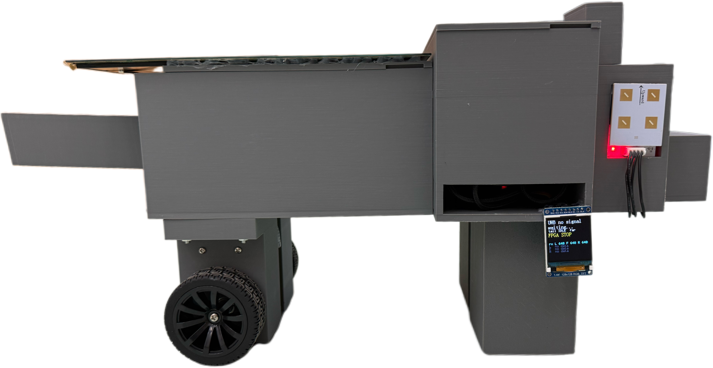
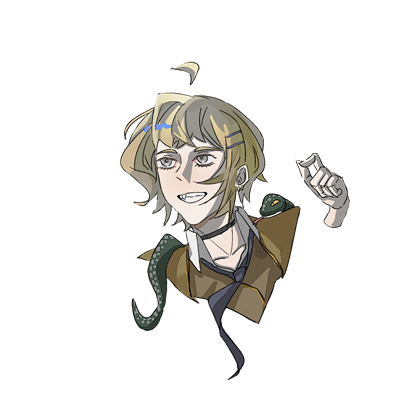
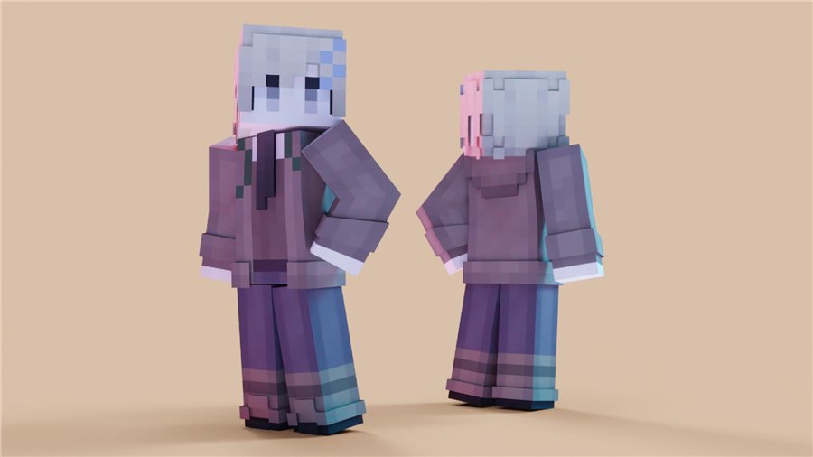

<div align="center">


### 汪！一只从方块世界跑出来的狗

基于**安路 PH1P35 FPGA** + **STM32F103RCT6** 的 Minecraft（我的世界）跟随机器狗


</div>

## 新的世界


我非常喜欢 Minecraft，每次玩都特别开心。挖矿、盖房子、一不小心掉进岩浆，回头一看，那只用骨头驯服的狗还跟在身后。

所以我决定把它合成出来：FPGA 当红石，3D 打印机当工作台，电机当腿。它真的走进了现实世界，会跟着我走，会吃骨头，找不到我的时候还会汪汪叫。

<div align="center">

| 游戏里的我和狗 | 现实里的狗 |
|:-:|:-:|
|  |  |

</div>

## 它会什么

| 技能 | 效果 |
| --- | --- |
| 跟着主人走 | 你走开它就跟上来，走到你身边两米内乖乖站好 |
| 绕开障碍 | 前面有东西就自己绕过去，死路里还会转一圈找出口 |
| 吃骨头 | 把骨头递到嘴边：咔嚓咔嚓，尾巴摇起来 |
| 摇尾巴 | 你走到三米以内，它就开心地左右摇 |
| 汪汪叫 | 你跑太远、信号丢了，或者它被困住了，都会大声叫你 |
| 狗眼看世界 | 背上的屏幕能看到它眼里的画面，哪里能走、哪里挡路一目了然 |
| 自带 BGM | 走到哪响到哪 |

<div align="center">

| 背上的屏幕 | 正脸 |
|:-:|:-:|
|  |  |

</div>

## 小麦信标


在游戏里，手里拿着小麦，动物就会跟着你走。所以我用积木拼了一把小麦，里面藏着 UWB 标签和电池。拿着它走，狗就跟着走。

（游戏里的狗其实不吃这一套，但这只吃。）

<div align="center">


</div>

<div align="center"></div>

## 合成表

### 物品栏

| 物品 | 用的是 | 在狗身上是 |
| --- | --- | --- |
| FPGA | 安路 **PH1P35**（PH1P35MDG324），米联客 MLKPAI-F02 + FC02 开发平台 | 大脑 |
| 单片机 | **STM32F103RCT6** + 1.44 寸彩屏 | 小跟班，管 UWB 和轮子 |
| 摄像头 | 米联客 MLK-CAM002（Sony IMX415，4.2 mm 镜头） | 眼睛 |
| 屏幕 | 米联客 10.1 英寸 MIPI 屏（800×1280） | 背上的显示屏 |
| UWB 基站 | 爱蓝信 ALX-G100A（AOA 测角测距）× 4 | 鼻子，闻得出主人在哪 |
| UWB 标签 | OverAir U68 + 2000 mAh 电池 | 藏在小麦信标里 |
| 陀螺仪 | 维特 JY61P | 方向感 |
| 电机驱动 | TB6612 双路驱动模块带稳压版（D153C） | 腿上的肌肉 |
| 轮子 | 直流减速电机 × 2 | 腿 |
| 尾巴电机 | 张大头 ZDT Emm42（X42S 闭环步进） | 尾巴！ |
| 喂食检测 | 霍尔传感器模块 + 藏着磁铁的骨头 | 嘴 |
| 声音 | ES8388 + 3020 腔体喇叭（4 Ω 3 W）× 2 + TF 卡 | 嗓子 |
| 电源 | 2S 锂电池 + 5 V 降压 | 饱食度 |
| 外壳 | 3D 打印 | 方块身体 |

### 工作台

| 用来做 | 平台 |
| --- | --- |
| FPGA（Verilog） | 安路 Tang Dynasty（TD）6.2.1，仿真用 Icarus Verilog |
| STM32（C） | STM32CubeMX + STM32CubeIDE |
| 3D 模型 | Autodesk Fusion 360 |

## 地图

```text
MinecraftDog/
├── Minecraft_MLKfpgacode/        FPGA 代码，详细说明看里面的 README
│   └── mcproject_code/           TD 工程，源码在 src/rtl，bit 在 src/boot
├── Minecraft_MCU/
│   ├── MinecraftDog_STM32/       STM32 代码，详细说明看里面的 README
│   └── MinecraftDog_mspm0/       早期的 MSPM0 版本，已经不用
├── 3Dmodel/
│   ├── MinecraftDog_FPGA.f3d     Fusion 360 源文件，可以直接打开改
│   ├── MinecraftDog_FPGA.stl     整只狗
│   └── stls/                     每个零件的 STL，拿去就能打印
├── source/                       音效、比赛资料、技术文档、原图素材
├── assets/                       这个页面用的图
└── FPGA开发记录.md               一路踩过的坑，和技术文档要改的地方
```

## 拆开来长这样


外壳在 Fusion 360 里建模，分成一块块打印再拼起来。源文件放在 `3Dmodel/` 了。

<div align="center">

</div>

## 成就

- [x] **跟我来** 第一次跟着小麦走起来
- [x] **好狗狗** 走到主人身边，自己停下
- [x] **汪！** 主人走远了，急得叫出声
- [x] **开饭啦** 吃到骨头，摇起了尾巴
- [x] **回头是岸** 被围住也能转圈找到出口


## 作者




一个每次打开 Minecraft 都很开心的人。

<br clear="left">

<div align="center">

</div>

<div align="center"></div>

<div align="center">

为 2026 全国大学生嵌入式芯片与系统设计竞赛 FPGA 赛道（安路科技选题）而做，更为了开心。

<sub>这是一个粉丝作品，和 Mojang、Microsoft 没有任何关系。方块、生物的图片和游戏截图来自 Minecraft，版权归 Mojang；标题图是自己画的。<br>
Minecraft 是 Mojang Synergies AB 的商标。NOT AN OFFICIAL MINECRAFT PRODUCT. NOT APPROVED BY OR ASSOCIATED WITH MOJANG OR MICROSOFT.</sub>

</div>
