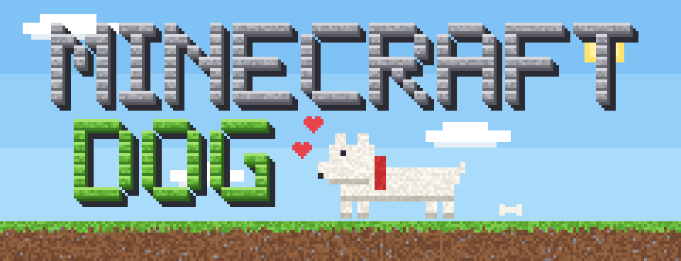
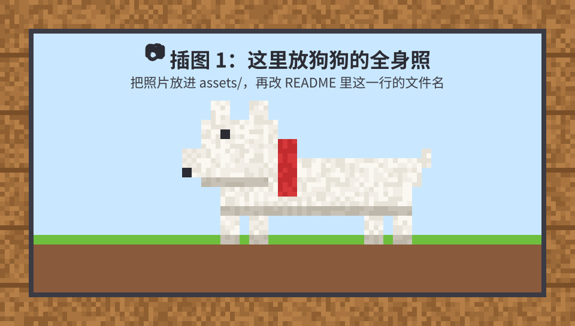
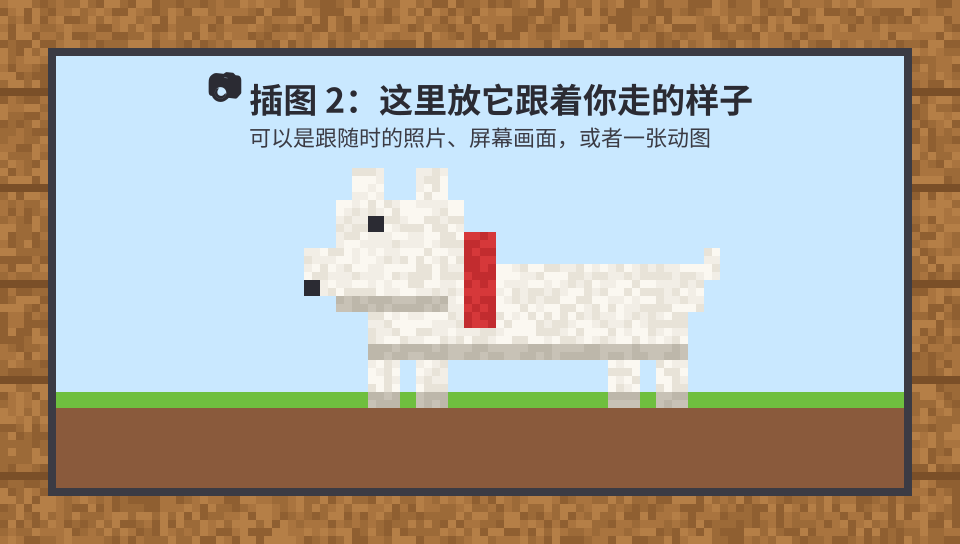
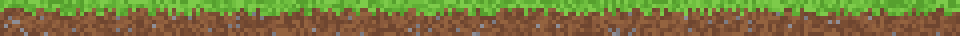
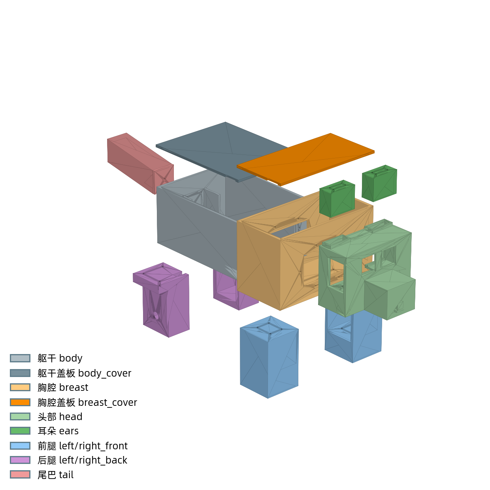

<div align="center">



### 🐾 汪！一只从方块世界跑出来的狗

基于**安路 PH1P35 FPGA** + **STM32F103RCT6** 的 Minecraft（我的世界）跟随机器狗


</div>

## 🌱 新的世界

我非常喜欢 Minecraft，每次玩都特别开心。挖矿、盖房子、一不小心掉进岩浆，回头一看，那只用骨头驯服的狗还跟在身后。

可是退出游戏，狗就不见了。这不行。

所以我决定把它合成出来：FPGA 当红石，3D 打印机当工作台，电机当腿。现在它真的走进了现实世界，会跟着我走，会吃骨头，找不到我的时候还会急得汪汪叫。

<!-- 📷 插图 1：把照片放进 assets/，再把下面的 photo_1.svg 换成照片的文件名 -->
<div align="center">

</div>

## 🐺 它会什么

| 技能 | 效果 |
| --- | --- |
| 🐾 跟着主人走 | 你走开它就跟上来，走到你身边两米内乖乖站好 |
| 🧱 绕开障碍 | 前面有东西就自己绕过去，死路里还会转一圈找出口 |
| 🦴 吃骨头 | 把骨头递到嘴边：咔嚓咔嚓，尾巴摇起来 |
| 💖 摇尾巴 | 你走到三米以内，它就开心地左右摇 |
| 🔊 汪汪叫 | 你跑太远、信号丢了，或者它被困住了，都会大声叫你 |
| 📺 狗眼看世界 | 屏幕上能看到它眼里的画面，哪里能走、哪里挡路一目了然 |
| 🎵 自带 BGM | 走到哪响到哪 |

<!-- 📷 插图 2：把照片或动图放进 assets/，再把下面的 photo_2.svg 换成文件名 -->
<div align="center">

</div>

<div align="center"></div>

## 🧰 合成表

<div align="center">

| | | | | |
|:-:|:-:|:-:|:-:|:-:|
| 🧠 | 👁️ | 📡 | | |
| ⚙️ | 🧱 | 🔋 | ➡️ | 🐕 |
| 🦴 | 🔊 | 🐾 | | |

*请在工作台上摆放，不支持 2×2 背包合成*

</div>

### 🎒 物品栏

| 物品 | 用的是 | 在狗身上是 |
| --- | --- | --- |
| 🧠 FPGA | 安路 **PH1P35**（PH1P35MDG324），米联客 MLKPAI-F02 + FC02 开发平台 | 大脑 |
| 🧩 单片机 | **STM32F103RCT6** + 1.44 寸彩屏 | 小跟班，管 UWB 和轮子 |
| 👁️ 摄像头 | 米联客 MLK-CAM002（Sony IMX415） | 眼睛 |
| 📺 屏幕 | 米联客 10.1 英寸 MIPI 屏（800×1280） | 让你看见它在想什么 |
| 📡 UWB | 定向基站 × 3 + 主人身上的信标 | 鼻子，闻得出主人在哪 |
| 🧭 陀螺仪 | 维特 JY61P | 方向感 |
| ⚙️ 轮子 | 直流减速电机 × 2 + 电机驱动 | 腿 |
| 🐕 尾巴 | ZDT X42S 闭环步进电机 | 尾巴！ |
| 🧲 喂食 | 霍尔传感器 + 藏着磁铁的骨头 | 嘴 |
| 🔊 声音 | ES8388 + 喇叭 × 2 + TF 卡 | 嗓子 |
| 🔋 电源 | 2S 锂电池 + 5 V 降压 | 饱食度 |
| 🧱 外壳 | 3D 打印 | 方块身体 |

### 🛠️ 工作台

| 用来做 | 平台 |
| --- | --- |
| FPGA（Verilog） | 安路 Tang Dynasty（TD）6.2.1，仿真用 Icarus Verilog |
| STM32（C） | STM32CubeMX + STM32CubeIDE |
| 3D 模型 | Autodesk Fusion 360 |

## 🗺️ 地图

```text
MinecraftDog/
├── Minecraft_MLKfpgacode/        🧠 FPGA 代码，详细说明看里面的 README
│   └── mcproject_code/           TD 工程，源码在 src/rtl，bit 在 src/boot
├── Minecraft_MCU/
│   └── MinecraftDog_STM32/       🧩 STM32 代码，详细说明看里面的 README
├── 3Dmodel/
│   ├── MinecraftDog_FPGA.f3d     🧱 Fusion 360 源文件，可以直接打开改
│   ├── MinecraftDog_FPGA.stl     整只狗
│   └── stls/                     每个零件的 STL，拿去就能打印
└── source/                       🎒 音效、比赛资料、技术文档
```

## 🧊 拆开来长这样

外壳在 Fusion 360 里建模，分成一块块打印再拼起来。源文件也一起放在 `3Dmodel/` 了，想给它换个皮肤、做一只猫都可以。

<div align="center">

</div>

## 🏆 成就

- ✅ **跟我来** 第一次跟着主人走起来
- ✅ **好狗狗** 走到主人身边，自己停下
- ✅ **汪！** 主人走远了，急得叫出声
- ✅ **开饭啦** 吃到骨头，摇起了尾巴
- ✅ **回头是岸** 被围住也能转圈找到出口
- ⬜ **绕墙大师** 和地板一个颜色的墙，还在努力练习

<div align="center"></div>

<div align="center">

为 2026 全国大学生嵌入式芯片与系统设计竞赛 FPGA 赛道（安路科技选题）而做，更为了开心。

<sub>这是一个粉丝作品，和 Mojang、Microsoft 没有任何关系，插图都是自己画的。<br>
Minecraft 是 Mojang Synergies AB 的商标。NOT AN OFFICIAL MINECRAFT PRODUCT. NOT APPROVED BY OR ASSOCIATED WITH MOJANG OR MICROSOFT.</sub>

</div>
