<div align="center">

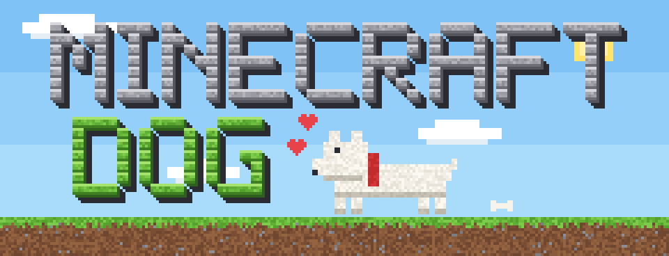

### Woof! A dog that ran out of the block world

A Minecraft follower robot dog built on an **Anlogic PH1P35 FPGA** + **STM32F103RCT6**


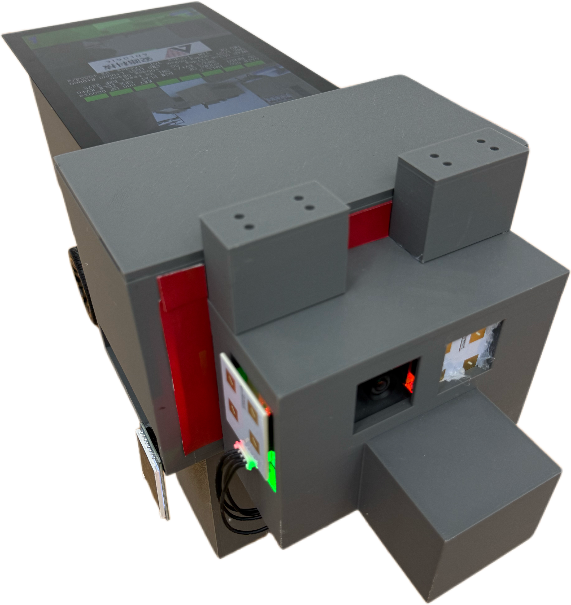

</div>

<div align="center"></div>

## A New World


I love Minecraft, and every time I play it I have a great time. Mining, building, accidentally falling into lava, and when I look back, the dog I tamed with a bone is still right behind me.

<div align="center">
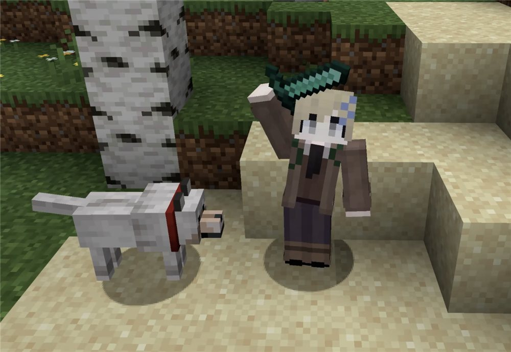
</div>

## What It Can Do

| Skill | What happens |
| --- | --- |
| Follows its owner (the beacon) | Walk away and it catches up, then stands still within two meters of you |
| Avoids obstacles | Steers around anything in its way, and in a dead end it turns around to find a way out |
| Feeding | Hold food up to its mouth: it plays the eating sound and wags its tail |
| Tail wagging | Wags its tail when you are within three meters |
| Barking | Barks loudly for you when you get too far away, the signal drops, or it gets stuck |
| Dog's-eye view | The screen on its back shows what it sees, so you can tell at a glance where it can go and what is in the way |
| Its own BGM | Music plays wherever it goes |

<div align="center">

| Screen on its back | Face |
|:-:|:-:|
| 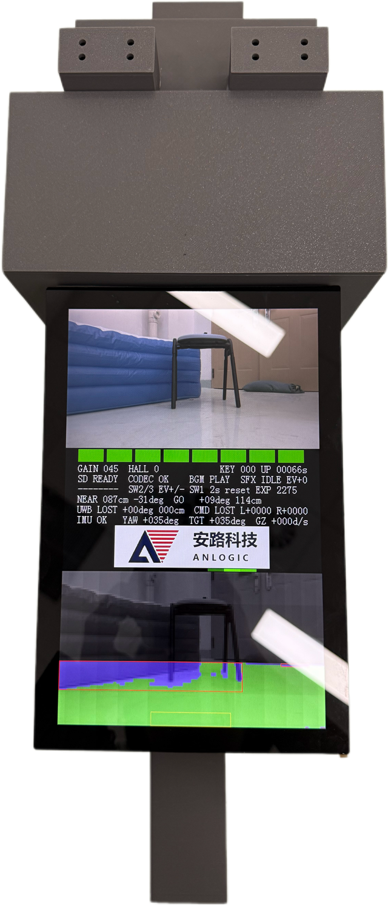 | 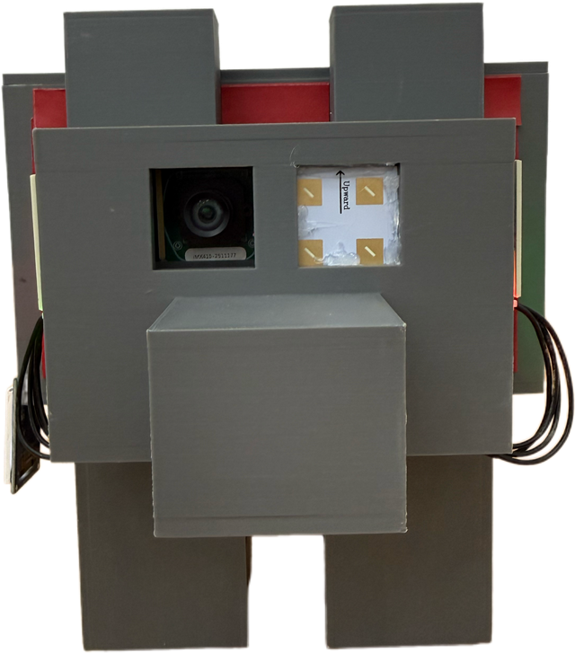 |

</div>

## The Wheat Beacon

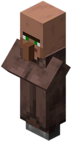

I built a bundle of wheat out of toy bricks and put a UWB tag and a battery inside. Carry it around and the dog follows.

(In the game, dogs don't actually go for wheat. This one does.)

<div align="center">
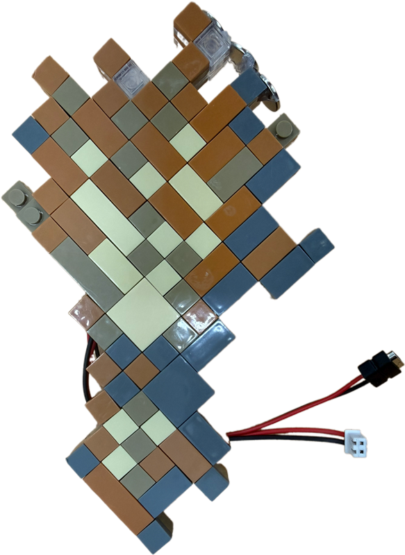
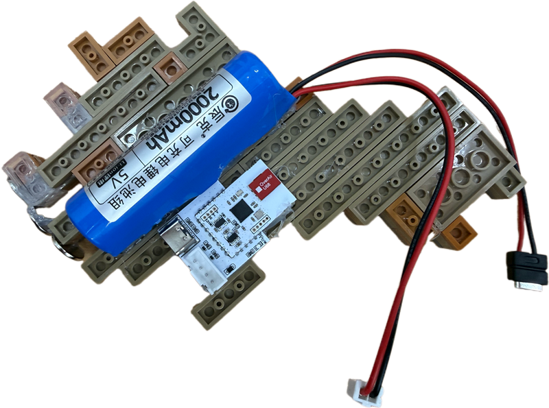
</div>

<div align="center"></div>

## Crafting Recipe

### Inventory

| Item | Part | On the dog |
| --- | --- | --- |
| FPGA | Anlogic **PH1P35** (PH1P35MDG324), MiLianKe MLKPAI-F02 + FC02 development platform | Brain |
| MCU | **STM32F103RCT6** + 1.44-inch color LCD | Lower-level controller for UWB and the wheels |
| Camera | MiLianKe MLK-CAM002 (Sony IMX415, 4.2 mm lens) | Eyes |
| Display | MiLianKe 10.1-inch MIPI panel (800×1280) | Screen on its back |
| UWB anchors | ALX-G100A (AoA angle and distance) × 4 | Nose that sniffs out where its owner is |
| UWB tag | OverAir U68 + 2000 mAh battery | Hidden in the wheat beacon |
| IMU | WitMotion JY61P | Sense of direction |
| Motor driver | TB6612 dual-channel driver module with regulator (D153C) | Leg muscles |
| Wheels | DC gear motors × 2 | Legs |
| Tail motor | ZDT Emm42 (X42S closed-loop stepper) | The tail! |
| Feeding sensor | Hall sensor module + a bone with a hidden magnet | Mouth |
| Sound | ES8388 + 3020 cavity speakers (4 Ω 3 W) × 2 + TF card | Voice |
| Power | 12 V lithium battery packs (2550 mAh) × 2 + 5 V regulator | Hunger bar |
| Shell | 3D printed | Blocky body |

### Crafting Table

| Used for | Tools |
| --- | --- |
| FPGA (Verilog) | Anlogic Tang Dynasty (TD) 6.2.1, simulated with Icarus Verilog |
| STM32 (C) | STM32CubeMX + STM32CubeIDE |
| 3D model | Autodesk Fusion 360 |

## Map

```text
MinecraftDog/
├── Minecraft_MLKfpgacode/        FPGA code, see the README inside (in Chinese)
│   └── mcproject_code/           TD project: sources in src/rtl, bitstreams in src/boot
├── Minecraft_MCU/
│   ├── MinecraftDog_STM32/       STM32 code, see the README inside (in Chinese)
│   └── MinecraftDog_mspm0/       early MSPM0 version, no longer used
├── 3Dmodel/
│   ├── MinecraftDog_FPGA.f3d     Fusion 360 source file, open it and edit
│   ├── MinecraftDog_FPGA.stl     the whole dog
│   └── stls/                     STL for every part, ready to print
├── source/                       sound effects, competition files, report, original art
├── assets/                       images for this page
└── FPGA开发记录.md               dev log (in Chinese): pitfalls along the way, report notes
```

## Taken Apart

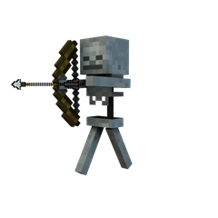

The shell was modeled in Fusion 360, printed in separate pieces and then put together. The source files are in `3Dmodel/`.

<div align="center">
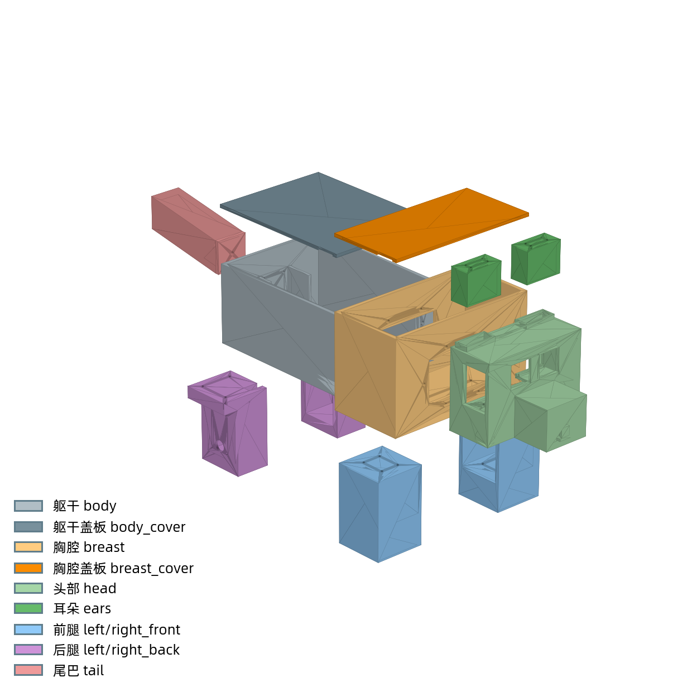
</div>

## Achievements

- [x] **Follow Me** Walked after the wheat for the first time
- [x] **Good Dog** Reached its owner and stopped on its own
- [x] **Woof!** Its owner wandered too far, so it barked
- [x] **Dinner Time** Ate a bone and wagged its tail
- [x] **Way Out** Boxed in, it turned around and found an exit

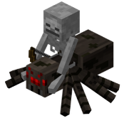

## Author

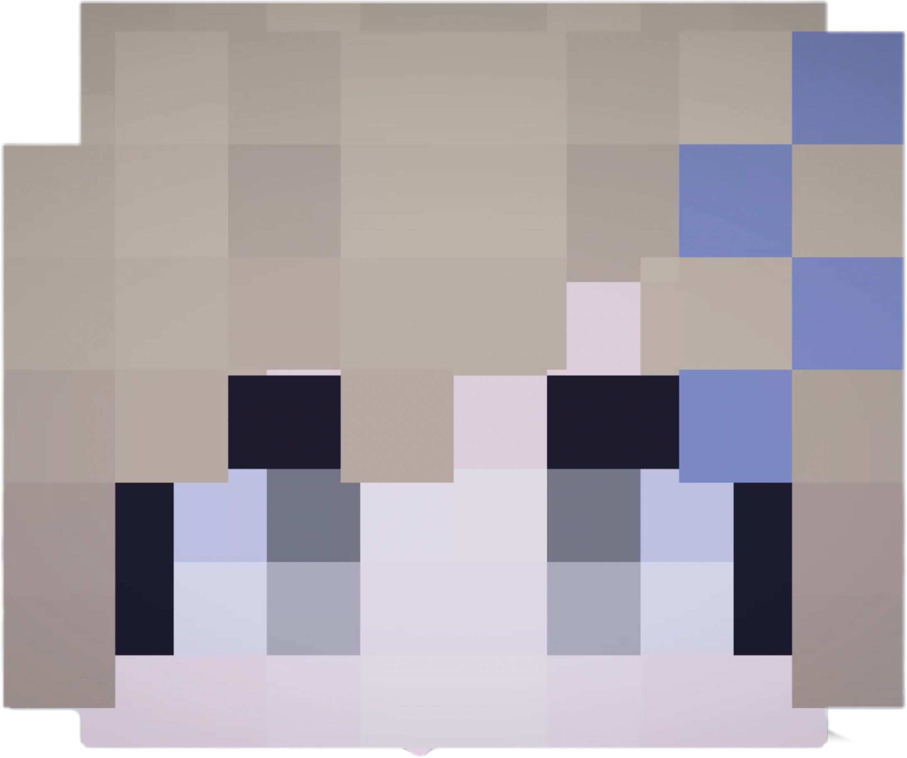

Someone who has a great time every time they open Minecraft.

<br clear="left">

<div align="center"></div>

<div align="center">

<sub>This is a fan project with no connection to Mojang or Microsoft. The block and mob images and the game screenshots come from Minecraft and are copyrighted by Mojang; the title image was drawn by me.<br>
Minecraft is a trademark of Mojang Synergies AB. NOT AN OFFICIAL MINECRAFT PRODUCT. NOT APPROVED BY OR ASSOCIATED WITH MOJANG OR MICROSOFT.</sub>

</div>
